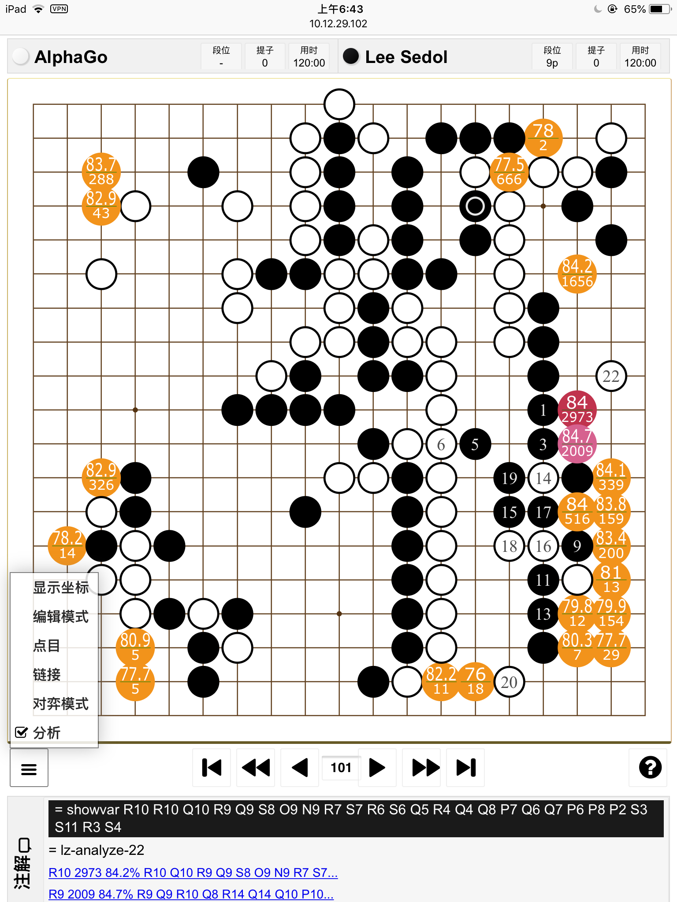

# Webgo

# Introducción
Utilice un navegador web para acceder a un programa de IA para Go en un ordenador remoto.
El ordenador remoto puede ser una computadora personal o un servicio de computación en la nube. Actualmente, la parte del servidor de Webgo puede soportar Leela Zero en Windows, Mac o Linux, y soportar Zen6 y Zen7 en Windows.
De este modo, podrá jugar partidas o analizar kifu con la IA.



# Agradecimientos y Dependencias
1. La página web se basa en [WGo.js](https://github.com/waltheri/wgo.js).
2. El lado del servidor se basa en [Leela Analysis Scripts](https://github.com/lightvector/leela-analysis)
3. El lado del servidor depende de los módulos de Python: bottle, gevent y gevent-websocket
4. También se utilizan algunos temas de [Sabaki](https://github.com/SabakiHQ/Sabaki), que es mi interfaz de usuario favorita para Go.
5. Gracias a los pesos de Leela Zero más fuertes de hzy (4b32f), los incluí en el paquete de lanzamiento para Windows.

# Uso de Webgo en Windows
1. Descargue el paquete [release](https://github.com/zliu1022/Webgo/releases/download/v0.3/Webgo-20190319.7z) y descomprímalo
2. Haga clic en start.bat
3. Abra la página según el mensaje de la consola
A continuación se muestra un ejemplo:
```
please enter URL: http://192.168.1.66:8000/webgo.html
```

# Uso de Webgo en Mac
1. Compile y ejecute leelazero; consulte el readme de [leela-zero](https://github.com/leela-zero/leela-zero/blob/master/README.md)
```
ruby -e "$(curl -fsSL https://raw.githubusercontent.com/Homebrew/install/master/install)"
brew install boost
git clone -b next https://github.com/gcp/leela-zero.git
Compile leelaz
get weight
```
2. Instale Webgo
```
sudo easy_install pip
sudo pip install bottle
pip install --user greenlet
pip install --user gevent
pip install --user gevent-websocket
```
Si falla, quizás necesite instalar pyenv y luego usar pyenv para instalar otra versión de Python.
Ejecute `pyenv global 2.7.11` para cambiar de versión, pero le deseo suerte.
```
mkdir github
cd github
git clone https://github.com/zliu1022/Webgo.git -b next Webgo-next
cd Wegbo-next
mkdir dist
```
3. Configurar motor y pesos
```
cp leelaz ~/github/Webgo/dist/leelaz
cp network.gz ~/github/Webgo/dist/network.gz
```
4. Ejecute el servidor y abra el puerto correspondiente del firewall
```
python svr/webgo.py
```

# Uso de Webgo en Google Cloud
1. Compile y ejecute leelazero; consulte el readme de [leela-zero](https://github.com/leela-zero/leela-zero/blob/master/README.md)
2. Instale Webgo
```
sudo apt install python-minimal
sudo apt install python-pip
pip install bottle gevent gevent-websocket
mkdir github
cd github
git clone https://github.com/zliu1022/Webgo.git -b next Webgo-next
cd Wegbo-next
mkdir dist
```
3. Configurar motor y pesos
```
cp leelaz ~/github/Webgo/dist/leelaz
cp network.gz ~/github/Webgo/dist/network.gz
```
4. Ejecute el servidor y abra el puerto correspondiente del firewall
```
python svr/webgo.py
```

# Configuración del Servidor
Cambie la opción de línea de comandos en leelaz.py
```
xargs = ['-t8', '--gpu', '0', '--gpu', '1']
```

# Licencia
El código se publica bajo la licencia AGPLv3 o posterior.
